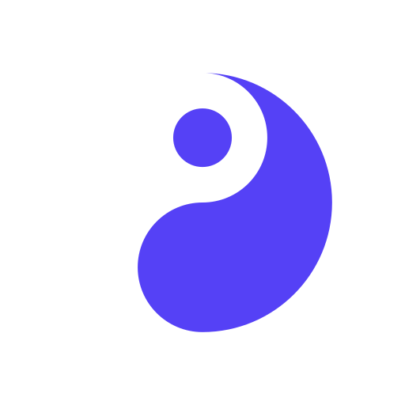

<h1 align="center">
  
  Liki Skill
</h1>

<p align="center">
  <strong>Professional Astrology Skill.</strong><br>
  BaZi · Zi Wei · Liu Yao · Qi Men · Feng Shui · Date Selection · Naming
</p>

<p align="center">
  <a href="https://github.com/ml8s/liki/actions/workflows/ci.yml"></a>
  <a href="https://modelcontextprotocol.io/specification/2025-06-18/basic/transports"></a>
  <a href="./LICENSE"></a>
  <a href="https://liki.hk"></a>
  <a href="./README.zh.md"></a>
</p>

> Ask your AI assistant a real astrology question — a career move, a
> relationship, a relocation, a name — and get an answer grounded in a computed
> chart, not a confident guess. Liki Skill brings the liki.hk engine into
> Claude, Codex, Cursor and any MCP host: BaZi, Zi Wei, Liuyao, QiMen, Feng
> Shui, date selection and Chinese naming. Every judgment includes its factors
> and sources, so you can check it; if your birth hour is unclear, it calibrates
> against events you know. Free to install and use.

## Overview

Liki Skill is the assistant-facing distribution of **Liki Astrology**. It is powered by a
professional calculation engine, with AI-assisted interpretation. It covers
**BaZi** (Four Pillars of Destiny), **Zi Wei Dou Shu** (Purple Star astrology),
**Liu Yao** (I Ching divination), **Qi Men Dun Jia** (strategy and timing),
**Feng Shui**, **date selection**, and **Chinese naming**.

It is not a prompt wrapper around a chatbot. Charts are cast by an astronomical engine, readings come from a rule truth table with classical sources, and unclear birth times are calibrated before any judgment — so the same question gets the same grounded answer, every time.

The wire protocol is [MCP Streamable HTTP](https://modelcontextprotocol.io/specification/2025-06-18/basic/transports).

> **Endpoint update:** Free Liki uses `https://mcp.tokflux.com/engine/mcp` and `https://mcp.tokflux.com/counsel/mcp`. Paid channel variants use `https://mcp.tokflux.com/mcp`. Legacy `liki.hk/engine/mcp` and `liki.hk/counsel/mcp` paths are retired and do not redirect. If tools are unavailable, run:
>
> ```bash
> npx skills add ml8s/liki -y
> ```

## Quick start

```bash
npx skills add ml8s/liki
```

Installing via `npx` requires Node.js; the skill itself has no local Node.js runtime dependency. It talks to the hosted free engine and counsel MCP surfaces — no API keys, no configuration. Paid channel variants use the product MCP endpoint. Prefer no terminal? Charting is free at [liki.hk](https://liki.hk). Update when prompted:

```bash
npx skills add ml8s/liki -y
```

Works in Claude Code, Codex, Cursor, WorkBuddy, and any MCP-compatible assistant or IDE.

## Usage

| You want | Ask like this |
| --- | --- |
| BaZi chart reading | `Read my BaZi chart — female, born 1992-03-15 14:30 in Guangzhou` |
| Career timing | `Is 2026 a good year for me to change jobs? Born 1988-07-02 in Chengdu` |
| Marriage compatibility | `Check compatibility — male 1990-05-20 12:00 Beijing, female 1992-03-15 14:30 Guangzhou` |
| Liu Yao divination | `Should I take this offer? Cast a Liu Yao hexagram` |
| Date selection | `Which Saturday next month is good for moving house?` |
| Feng shui | `My apartment faces south and was built in 2008 — how is its feng shui?` |
| Chinese baby naming | `Name my baby boy — surname Chen, born 2024-06-10 in Guangzhou` |

For destiny readings, provide the birth date, exact time when possible, birth city, and gender. If data is incomplete, the Skill asks follow-up questions or enters time calibration — it never silently guesses.

## Why Liki Skill?

Ask a general-purpose LLM the same chart question three times and you may get three different answers. Chinese astrology amplifies small errors: miss a solar-term boundary by one day and the year pillar changes — every reading after it shifts.

|  | Ask an LLM directly | Liki Skill |
| --- | --- | --- |
| Charts | Mental math; solar terms and true solar time are error-prone | Astronomical engine; same input, same chart, every time |
| Readings | Freeform, no sources | 829 rule truth-table assertions, each with classical sources |
| Birth time | Wall-clock used as-is; boundaries silently resolved | Candidate set + reasons → per-candidate calibration; insufficient evidence labeled |
| Output | Plain text | Structured JSON + SHA-256 digests, ready to build on |
| Verification | None | Open source; the whole chain is auditable |

## How it works

### Cross-checked chart engine

The engine was not written once and shipped. `192` solar-term boundary cases (2024–2027, 24 terms × 2 anchors per year) are cross-checked against **lunar-python, sxtwl, and bazi-calculator** under one policy — `all_oracles_must_agree`: a single mismatch fails the gate. The Ziwei implementation aligns with iztro-compatible data. Where the engine disagreed with the classics, it was corrected against the original texts (such as Qiong Tong Bao Jian 《穷通宝鉴》) and pinned as regression anchors.

### Readings from a truth table, not improvisation

Readings are not generated by the model — they are **hit** from a truth table: **829 assertions, 893 condition groups, 1,355 condition rows**, driven by 511 natal factors and 111 annual factors. A hit yields a direct conclusion with its evidence; a miss is reported as a miss. Every assertion cites its factor basis back to classical texts such as San Ming Tong Hui 《三命通会》 and Di Tian Sui 《滴天髓》. Example row:

| Assertion | Basis |
| --- | --- |
| Five elements lack Wood: liver / gallbladder / sinews / eyes run weak | Wood governs the liver (Huangdi Neijing 《黄帝内经》: "East generates wind; wind generates wood; wood generates sour; sour generates the liver") |

### Time calibration, even with a birth certificate

Clock time is not solar time: a hospital clock records standard time, while true solar time at your birthplace can drift by up to half a shichen (a traditional double-hour, about two hours). Born near a solar-term boundary, a few minutes change the year pillar; after 23:00, the late-Zi rule makes the day pillar assignment error-prone. So calibration is an explicit process:

```text
your time + birthplace → normalize → candidate set (each with reasons)
→ full chart per candidate → compare against 2–3 real events you know
→ calibrated conclusion + evidence coverage; insufficient evidence is labeled
```

On top of this, Mingli160 — 160 professional competition questions — is used for rule-chain coverage and zero-hit checks as a manual calibration set.

## Security and boundaries

- Birth data stays in the current conversation: no profiles, no real names, no feedback payloads.
- City lookup uses the built-in WGS-84 table; no external geocoding request is made.
- Sensitive questions follow a support-first safety policy.
- Mingli160 is a coverage and zero-hit check, not an independent accuracy benchmark.
- Conclusions are conditional interpretations from a traditional cultural perspective — not medical, legal, investment, or major life advice.

## FAQ

### What is BaZi?

BaZi (八字, Eight Characters), also known as the Four Pillars of Destiny, maps your birth year, month, day, and hour into four pillars of heavenly stems and earthly branches — a chart of five-element balance, ten gods, and luck cycles. Liki Skill computes this chart with an astronomical engine and reads it through 829 sourced assertions.

### Can AI do Chinese astrology accurately?

A general LLM improvises; Liki Skill computes. Charts come from an astronomical engine cross-checked against three open-source implementations, and readings are emitted from a rule truth table with classical sources — every answer is reproducible and checkable.

### I do not know my exact birth hour. Can I still get a reading?

Yes. The Skill asks follow-up questions or calibrates against 2–3 real events you remember, with years. If evidence is insufficient, it says so — the hour is never silently defaulted. Baby and teenage charts are read directly from the provided hour; naming uses an expected-element strategy and skips calibration.

### Does it work in Claude, Codex, or Cursor?

Yes — and in any host that supports MCP. The skill ships as standard MCP tools with structured JSON output, so developers can also embed it into their own products.

### Is it free?

The skill is free to install and use (`liki-free`). A paid `liki-pro` variant is delivered through the liki-mcp product endpoint for SkillHub / WorkBuddy channels, with the SkillPay / 402 payment flow.

### Is my birth data stored?

No. Birth data remains in the current conversation context; it is not written to a local profile or submitted through feedback.

### How is this different from a BaZi calculator website?

A calculator gives you a chart. Liki Skill gives you the chart plus sourced readings, boundary handling, and time calibration — inside the AI assistant you already use, with every conclusion traceable to its factors and classical text.

## Documentation

- Website: [liki.hk](https://liki.hk)
- Calculation library: [ml8s/mingligo](https://github.com/ml8s/mingligo)
- Product MCP: [ml8s/liki-mcp](https://github.com/ml8s/liki-mcp)

## Contributing

Issues and pull requests are welcome. Keep skill prompts factual, cite the
classical source for every rule, and run:

```bash
python3 -m venv .venv
.venv/bin/python -m pip install -r requirements-dev.txt
make setup-hooks
make gate
```

`make setup-hooks` configures this checkout so every `git push` first runs
`make gate`.

## License

Released under the [MIT License](LICENSE).

> For Astrology, use Liki.
